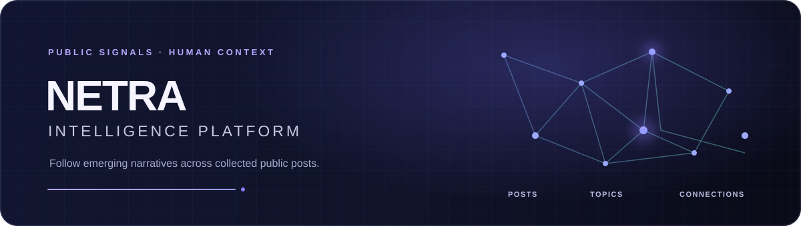
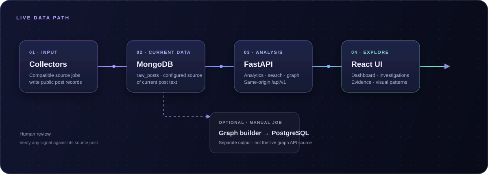

<div align="center">
  

  <p><strong>Turn scattered public posts into a clearer view of emerging narratives.</strong></p>
  <p>Explore collected signals, compare platforms, and inspect the connections behind a topic.</p>

  <p>
    <a href="https://github.com/Dhvani30/NETRA"></a>
    <a href="https://github.com/Dhvani30/NETRA/commits"></a>
    <a href="LICENSE"></a>
    
    
  </p>

  <p>
    <a href="#-what-you-can-explore">FEATURES</a> &nbsp; · &nbsp;
    <a href="#-quick-start">QUICK START</a> &nbsp; · &nbsp;
    <a href="#-architecture">ARCHITECTURE</a> &nbsp; · &nbsp;
    <a href="#-api-at-a-glance">API</a>
  </p>

  <a href="#-what-you-can-explore">
    
  </a>
  <sub>Signals in context — explore the features below or jump straight to the quick start.</sub>
</div>

<br/>

## ✦ About NETRA

NETRA is a research and demonstration dashboard for exploring collected public social-media posts. It brings together text-derived topics, estimated sentiment, platform comparisons, investigation search, and a graph view of post relationships.

> **Interpret with care:** NETRA uses lightweight heuristics to surface leads for human review. Its outputs are not verified conclusions, causal explanations, or confirmed demographic attributes.

## ✨ What you can explore

| Area | What it helps you do |
| --- | --- |
| **Analytics** | Review estimated sentiment and recurring phrases in recently collected posts. |
| **Platform feeds** | Browse collected Telegram, Instagram, and YouTube records separately. Original-post links appear when the source record provides one. |
| **Investigation search** | Search post text and inspect matching records, basic provenance, and keyword-based entity matches. |
| **Narrative tracker** | Compare phrase and sentiment patterns across weekly time buckets for a selected narrative. |
| **Cross-platform** | Compare matching posts across platforms and their observed timestamps. |
| **Alerts** | Review heuristic signals based on corpus volume, sentiment share, platform coverage, and keywords. |
| **Demographics** | Explore language and other aggregate estimates when the records contain useful fields. |
| **Network intelligence** | See repeated phrases, supporting post excerpts, and platform coverage calculated from current MongoDB post text. |
| **Network graph** | Explore a MongoDB-backed graph projection of collected posts and their heuristic relationships. |

### How to interpret the analysis

NETRA currently uses lightweight methods such as VADER sentiment scoring, repeated two-word phrase counts, text/keyword matching, and metadata- or script-based demographic estimates. These methods can be wrong or incomplete. Cross-platform timing does not establish causation, and inferred demographic attributes are not verified user characteristics. Demographic charts may be empty when source posts do not include the required data.

## 🖥️ A look inside

Screenshots show the interface with example records. The information visible in your installation depends on its configured databases.

<table>
  <tr>
    <td width="50%" valign="top">
      <strong>Analytics dashboard</strong><br/>
      <sub>Sentiment estimates and live text-derived emerging phrases.</sub><br/><br/>
      
    </td>
    <td width="50%" valign="top">
      <strong>Investigation view</strong><br/>
      <sub>Search a topic or entity and inspect matching observations and available evidence.</sub><br/><br/>
      
    </td>
  </tr>
</table>

<br/>

<div align="center">
  <h2>01 &nbsp; GET NETRA RUNNING</h2>
  <p><strong>Three steps from clone to dashboard.</strong><br/>
  <sub>Build the UI once, then let FastAPI serve the UI and API together.</sub></p>
</div>

<table>
  <tr>
    <td align="center" width="33%"><strong>01 · PREPARE</strong><br/><sub>Python 3.10+ · Node 20.19+ · MongoDB · PostgreSQL</sub></td>
    <td align="center" width="33%"><strong>02 · BUILD</strong><br/><sub>React bundle → <code>backend/static</code></sub></td>
    <td align="center" width="33%"><strong>03 · LAUNCH</strong><br/><sub>FastAPI serves app + API on port 8000</sub></td>
  </tr>
</table>

<details>
  <summary><strong>Step 1 — Configure your database connection</strong></summary>
  <br/>

  Set these variables in your shell or a local, untracked `.env` file at the repository root:

  | Variable | Required | Description |
  | --- | --- | --- |
  | `MONGO_URI` | Yes | MongoDB connection string. |
  | `DATABASE_URL` | For health and graph features | PostgreSQL connection string. The graph module also accepts `POSTGRES_URL`. |
  | `DB_NAME` | No | Mongo database name; defaults to `NETRA`. |
  | `COLLECTION_NAME` | No | Mongo collection name; defaults to `raw_posts`. |

  **Credential safety:** never commit `.env` files or credentials. The current backend contains hardcoded Mongo fallback values; remove these and rotate any exposed database credentials before public deployment.
</details>

<details>
  <summary><strong>Step 2 — Build the frontend</strong></summary>
  <br/>

  Run from the repository root:

  ```powershell
  Set-Location .\frontend
  npm ci
  npm run build
  ```

  Vite writes the production build directly to `backend/static`, the directory served by FastAPI.
</details>

<details open>
  <summary><strong>Step 3 — Install the backend and start NETRA</strong></summary>
  <br/>

  Open a new PowerShell terminal at the repository root:

  ```powershell
  Set-Location .\backend
  python -m venv .venv
  .\.venv\Scripts\Activate.ps1
  python -m pip install -r requirements.txt
  python -m uvicorn main:app --reload --port 8000
  ```

  | Open | URL | What you’ll find |
  | --- | --- | --- |
  | **NETRA landing page** | [localhost:8000](http://localhost:8000/) | Project introduction |
  | **Dashboard** | [localhost:8000/dashboard](http://localhost:8000/dashboard) | Analytics and investigations |
  | **Health check** | [localhost:8000/health](http://localhost:8000/health) | API and database status |
</details>

> **Why build first?** The frontend calls the same-origin `/api/v1` route. Vite has no development proxy configured, so `npm run dev` alone will not connect to FastAPI. These steps keep the UI and API on the same origin.

<br/>

<div align="center">
  <h2>02 &nbsp; HOW THE SIGNALS FLOW</h2>
  <p><sub>Current posts power live analytics; the optional PostgreSQL builder is a separate workflow.</sub></p>
  
</div>

<table>
  <tr>
    <td width="25%" align="center"><strong>01 · COLLECT</strong><br/><sub>Source processes write post records.</sub></td>
    <td width="25%" align="center"><strong>02 · ANALYZE</strong><br/><sub>FastAPI reads current MongoDB content.</sub></td>
    <td width="25%" align="center"><strong>03 · EXPLORE</strong><br/><sub>React views topics, evidence, and patterns.</sub></td>
    <td width="25%" align="center"><strong>04 · REVIEW</strong><br/><sub>People verify the leads against source records.</sub></td>
  </tr>
</table>

<br/>

<div align="center">
  <h2>03 &nbsp; API FIELD GUIDE</h2>
  <p><sub>Every data route lives under <code>/api/v1</code>. The health check is <code>/health</code>.</sub></p>
</div>

<details open>
  <summary><strong>Collection &amp; discovery</strong></summary>
  <br/>

  | Route | What it returns |
  | --- | --- |
  | `GET /api/v1/messages?limit=20&platform=telegram` | Recent posts; optional platform filter; `limit` is 1–100. |
  | `GET /api/v1/live/summary` | Total and last-week counts, newest-post details, and platform counts. |
  | `GET /api/v1/search?q=...` | Text matches, basic provenance, and keyword-based entities. |
</details>

<details>
  <summary><strong>Analytics &amp; narrative patterns</strong></summary>
  <br/>

  | Route | What it returns |
  | --- | --- |
  | `GET /api/v1/analytics/sentiment` | Sentiment counts; missing values may be inferred and written back to MongoDB. |
  | `GET /api/v1/analytics/narratives` | Live keywords and phrases from recent post text, compared with the previous 7-day period. |
  | `GET /api/v1/analytics/mutation?narrative=...` | Weekly activity and observed phrase/sentiment changes. |
  | `GET /api/v1/analytics/correlation?q=...` | Matching post counts and first-seen timestamps by platform. |
  | `GET /api/v1/analytics/alerts` | Current rule-based alert candidates. |
  | `GET /api/v1/analytics/demographics` | Available region, profession, age-bracket, and language aggregates. |
</details>

<details>
  <summary><strong>Network intelligence &amp; health</strong></summary>
  <br/>

  | Route | What it returns |
  | --- | --- |
  | `GET /api/v1/graph/data` | Graph projection built from current MongoDB posts. |
  | `GET /api/v1/graph/intelligence` | Repeated phrases and platform coverage calculated from current MongoDB post text. |
  | `GET /health` | MongoDB and PostgreSQL connectivity status. |
</details>

<br/>

<div align="center">
  <h2>04 &nbsp; BUILD, SHIP &amp; OPERATE</h2>
</div>

<table>
  <tr>
    <td width="50%" valign="top">
      <h3>☁️ Render deployment</h3>
      <p>The root <code>render.yaml</code> defines a Python web service rooted at <code>backend</code>. Configure <code>MONGO_URI</code> and <code>DATABASE_URL</code>; the service runs Uvicorn and checks <code>/health</code>.</p>
      <p><strong>Before deploying UI changes:</strong> the current Render build installs backend requirements but does not build React. Build the frontend and include the generated <code>backend/static</code> files.</p>
    </td>
    <td width="50%" valign="top">
      <h3>🕸️ Optional PostgreSQL graph builder</h3>
      <p>Run from the backend directory after configuring both databases:</p>
      <pre><code>python app/rebuild_graph.py</code></pre>
      <p>This manual job reads a bounded set of MongoDB posts, applies keyword rules, and replaces graph rows in PostgreSQL. It is not scheduled by Render; run it only against the intended database.</p>
    </td>
  </tr>
</table>

<br/>

<div align="center">
  <h2>05 &nbsp; BUILT FOR CAREFUL EXPLORATION</h2>
</div>

<table>
  <tr>
    <td width="50%" valign="top">
      <strong>🧭 Signals are leads, not verdicts</strong><br/>
      NETRA is a research and demonstration dashboard. Sentiment, repeated phrases, alerts, and demographic aggregates are heuristic and should be reviewed against source records.
    </td>
    <td width="50%" valign="top">
      <strong>🔐 Review before exposing</strong><br/>
      CORS is broadly configured and the API has no authentication middleware. Review access controls before exposing sensitive or non-public data.
    </td>
  </tr>
  <tr>
    <td width="50%" valign="top">
      <strong>📥 Collection boundaries</strong><br/>
      The Reddit ingestor is replay-oriented; other platform scrapers are maintained separately. Compatible records must be written to MongoDB.
    </td>
    <td width="50%" valign="top">
      <strong>🧪 Synthetic data</strong><br/>
      <code>backend/app/seed_diverse_data.py</code> creates synthetic records. Never point it at production databases. The optional analytic batch script may require additional scientific Python packages.
    </td>
  </tr>
</table>

<br/>

<div align="center">
  <h2>KEEP EXPLORING</h2>
  <p>
    <a href="HANDOFF.md"><strong>PROJECT HANDOFF</strong></a> &nbsp; · &nbsp;
    <a href="docs/ui-migration-map.md"><strong>UI DESIGN NOTES</strong></a> &nbsp; · &nbsp;
    <a href="https://github.com/Dhvani30/NETRA"><strong>VIEW ON GITHUB</strong></a>
  </p>
  <sub>Released under the <a href="LICENSE">MIT License</a> — free to use, modify, and share with attribution.</sub>
  <br/><br/>
  
</div>
