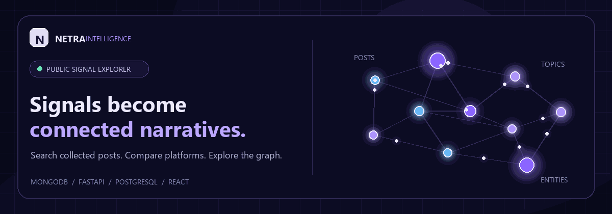
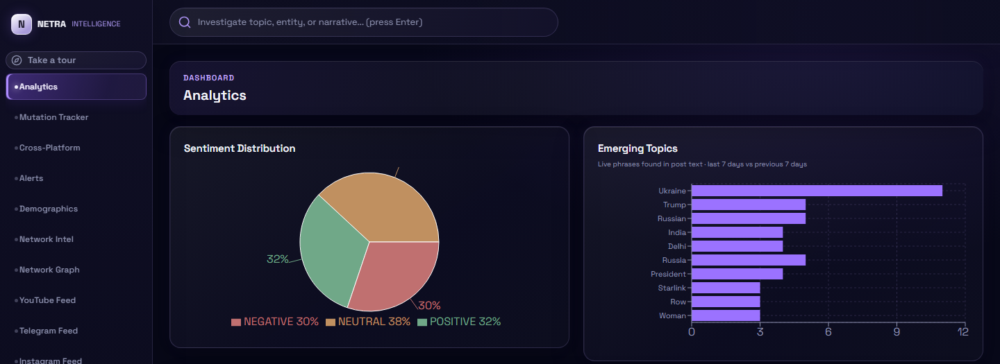
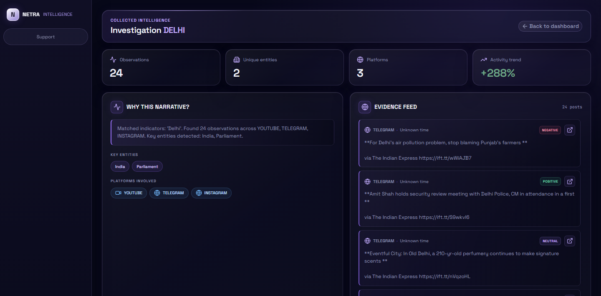
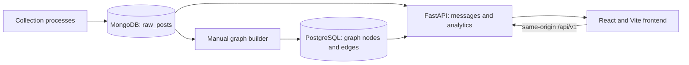

<div align="center">
  <h1>NETRA Intelligence Platform</h1>
  <p><strong>From scattered public posts to a clearer view of emerging narratives.</strong></p>
  <p>Explore collected signals, compare platforms, and inspect the connections behind a topic.</p>
  <p><a href="#what-you-can-explore">Explore features</a> &nbsp; | &nbsp; <a href="#run-locally">Quick start</a> &nbsp; | &nbsp; <a href="#how-it-is-put-together">Architecture</a> &nbsp; | &nbsp; <a href="#api-overview">API</a></p>
  <a href="#run-locally"></a>
  <p><sub>Click the signal map to jump to the quick start.</sub></p>
</div>

NETRA is a research and demonstration dashboard for exploring collected public social-media posts. It combines text-based topic discovery, estimated sentiment, cross-platform comparisons, investigation search, and a graph of post relationships. Its heuristic outputs are leads for review, not verified conclusions.

## Interface snapshots

Screenshots are interface captures with example records; displayed data depends on the configured databases.

### Analytics dashboard

The dashboard combines a sentiment estimate, candidate emerging topics, and separate Telegram, Instagram, and YouTube feeds.



### Investigation view

Search a topic or entity to inspect matching observations, detected keywords, platforms, and available evidence.



## What you can explore

- **Analytics:** Review estimated sentiment and recurring phrases in recently collected posts.
- **Platform feeds:** Browse collected Telegram, Instagram, and YouTube records separately. Original-post links are shown when the source record includes a usable URL.
- **Investigation search:** Search post text and review matching records, basic provenance, and keyword-based entity matches.
- **Narrative tracker:** Compare phrase and sentiment patterns across weekly time buckets for a selected narrative.
- **Cross-platform view:** Compare matching posts across platforms and their observed timestamps.
- **Alerts:** View heuristic signals based on corpus volume, sentiment share, platform coverage, and keywords.
- **Demographics:** Explore language and other aggregate estimates where records contain useful fields.
- **Network intelligence and graph:** Inspect PostgreSQL graph nodes, edges, degree-based rankings, and node-type summaries.
- **Guided tour:** Step through an explanation of the dashboard areas.

### How to read the analytics

NETRA currently uses lightweight methods: VADER sentiment scoring, repeated two-word phrase counts, text/keyword matching, and metadata or script-based demographic estimates. These methods can be wrong or incomplete. Cross-platform timing does not establish causation, and inferred demographic attributes are not verified user characteristics. Some demographic charts may be empty when source posts do not include the needed data.

## How it is put together



- **Frontend:** React 19, Vite, Recharts, `react-force-graph-2d`, and Lucide icons.
- **API:** FastAPI and Uvicorn.
- **Post storage:** MongoDB collection `raw_posts` by default.
- **Graph storage:** PostgreSQL tables `graph_nodes` and `graph_edges`.
- **Deployment:** Render configuration runs FastAPI, which serves the prebuilt frontend from `backend/static`.

The graph builder is a manual script; the deployed API does not automatically sync new posts into PostgreSQL. The included Reddit ingestor is replay-oriented. The platform scrapers used to populate the other feeds live outside this repository, so those screens require compatible records to be written to MongoDB.

## Run locally

### Requirements

- Python 3.10 or newer.
- Node.js `^20.19.0` or `>=22.12.0` (required by the checked-in Vite version).
- Reachable MongoDB and PostgreSQL instances, with database credentials supplied through environment variables.

### 1. Configure the backend

Set these environment variables in your shell or in a local, untracked `.env` file at the repository root:

| Variable | Required | Description |
| --- | --- | --- |
| `MONGO_URI` | Yes | MongoDB connection string. |
| `DATABASE_URL` | Yes for health and graph features | PostgreSQL connection string. `POSTGRES_URL` is accepted as a fallback by the graph module. |
| `DB_NAME` | No | Mongo database name; defaults to `NETRA`. |
| `COLLECTION_NAME` | No | Mongo collection name; defaults to `raw_posts`. |

Do not commit `.env` or put credentials in source code. The current backend contains hardcoded Mongo fallback values; remove these and rotate any exposed database credentials before using a public deployment.

### 2. Build the frontend

Run these commands from the repository root:

```powershell
Set-Location .\frontend
npm ci
npm run build
```

Vite writes the production build directly to `backend/static`, the directory FastAPI serves.

### 3. Install and start FastAPI

Return to the repository root first if you opened a new PowerShell terminal, then run:

```powershell
Set-Location .\backend
python -m venv .venv
.venv\Scripts\Activate.ps1
python -m pip install -r requirements.txt
python -m uvicorn main:app --reload --port 8000
```

If your terminal is still in `frontend` after building, use `Set-Location ..\backend` instead.

Open [http://localhost:8000/](http://localhost:8000/). The API health endpoint is [http://localhost:8000/health](http://localhost:8000/health).

The frontend uses the relative API path `/api/v1`. Vite is not configured with a development proxy, so running only `npm run dev` will not connect API calls to FastAPI. The build-and-serve steps above run the UI and API on the same origin, as expected by the current configuration.

## API overview

All data endpoints use the `/api/v1` prefix.

| Endpoint | Returns |
| --- | --- |
| `GET /health` | MongoDB and PostgreSQL connectivity status. |
| `GET /api/v1/messages?limit=20&platform=telegram` | Recent posts, optionally filtered by platform. `limit` is between 1 and 100. |
| `GET /api/v1/live/summary` | Total and last-week post counts, newest-post details, and platform counts. |
| `GET /api/v1/analytics/sentiment` | Sentiment counts; missing values may be inferred and written back to MongoDB. |
| `GET /api/v1/analytics/narratives` | Live keywords and phrases extracted from recent post text, compared with the previous 7-day period. |
| `GET /api/v1/search?q=...` | Text matches, basic provenance, and keyword-based entities. |
| `GET /api/v1/analytics/mutation?narrative=...` | Weekly activity and observed phrase/sentiment changes. |
| `GET /api/v1/analytics/correlation?q=...` | Matching post counts and first-seen timestamps grouped by platform. |
| `GET /api/v1/analytics/alerts` | Current rule-based alert candidates. |
| `GET /api/v1/analytics/demographics` | Available region, profession, age-bracket, and language aggregates. |
| `GET /api/v1/graph/data` | A graph projection built from current MongoDB posts. |
| `GET /api/v1/graph/intelligence` | Repeated phrases and platform coverage calculated from current MongoDB post text. |

## Graph data

After configuring MongoDB and PostgreSQL, run the graph builder from the backend directory to populate the graph tables:

```powershell
python app/rebuild_graph.py
```

It reads a bounded set of posts from MongoDB, applies keyword rules to assign topics, narratives, and entities, then upserts nodes and relationships in PostgreSQL. It is not scheduled by the Render service, and it does not remove stale graph rows. Run it only when the configured database is the intended target.

## Deploying on Render

The root `render.yaml` defines a Python web service with `backend` as its root directory. Configure `MONGO_URI` and `DATABASE_URL` in the Render service environment. The service runs Uvicorn and uses `/health` as its health check.

The current Render build command installs backend requirements but does **not** build the React application. Build the frontend and include the resulting files in `backend/static` before deploying frontend changes. The API and UI then share the Render service's origin; the frontend expects `/api/v1` on that same origin.

## Repository notes

- The main graph implementation uses PostgreSQL; Neo4j in the local Docker setup is not used by the current API routes.
- `backend/app/collectors/reddit_ingestor.py` is the only collector included here and is replay-oriented. Other source collectors are maintained separately.
- `backend/app/analytic_engine.py` is an optional batch script; some of its scientific Python imports are not listed in `backend/requirements.txt`.
- `backend/app/seed_diverse_data.py` creates synthetic data. Do not point it at production databases.
- CORS is broadly configured and the API has no authentication middleware in the current implementation. Review access controls before exposing sensitive or non-public data.

## Further reading

- [Full project handoff](HANDOFF.md) — architecture, screens, routes, operations, and known limitations.
- [UI migration map](docs/ui-migration-map.md) — frontend design/reference notes.

## License

No license file is currently included. All rights reserved unless the repository owner adds a license.
